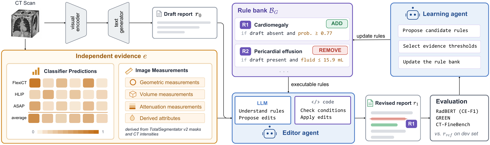
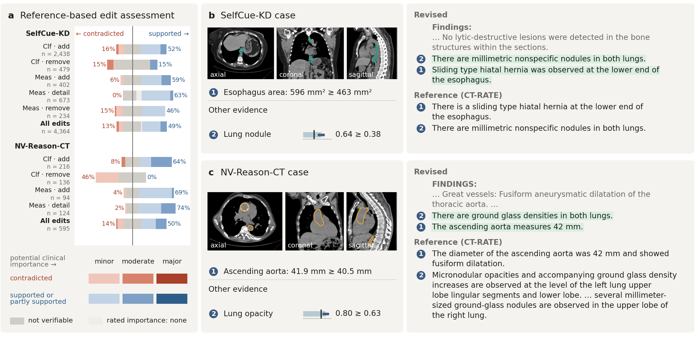

# CT-RuleBank

**Learning a Rule Bank to Revise 3D CT Reports with Independent Evidence**

Vision–language models write fluent reports from 3D chest CT, but they still miss abnormalities or misstate findings. CT-RuleBank revises a
draft report with independent image evidence: classifier probabilities and segmentation measurements. An LLM agent learns a rule
bank for each report model from revision outcomes on development cases. At inference, the rules that fire make local edits to the draft.
Sentences that are not edited stay the same, each change is traced to the rule that made it, and the report model is not retrained.



On CT-RATE, revision raises CE-F1 by 11.5 points for SelfCue-KD and 0.9 points for NV-Reason-CT, and raises SelfCue-KD's CT-FineBench
score by 15.2 points.



## What is in this repository

| Path | Contents |
|---|---|
| `rulebank/` | The method: rule agent (`learner.py`, `prompts.py`), code-only gate (`gate.py`), evidence tables (`evidence.py`), code edits (`edits/`), editor agent (`editor.py`), applying a bank (`apply.py`) |
| `steps/stage2_learn_bank.py` | Learns a rule bank for one report model |
| `steps/stage3_apply_bank.py` | Applies a learned bank to draft reports |
| `configs/` | The final configuration: experiment (`experiments/final_ma1_p50.yaml`), evidence set (`evidence/main.yaml`), editor (`editor/gptoss.yaml`) |
| `banks/` | The learned rule banks for SelfCue-KD and NV-Reason-CT (`banks.json`, plus a readable `bank_final_ma1_p50.md`) |

Each rule has a condition on one piece of evidence (for example `clf:Pleural effusion >= 0.8727` or `pericardial_ml >= 34.1`), an edit
(add, remove, or add a measured detail) and the outcome it had on the development cases.

## Usage

```bash
# learn a bank (gpt-oss-120b served by a local vLLM server)
python -m steps.stage2_learn_bank --config configs/experiments/final_ma1_p50.yaml --gen selfcue --out-root results --base-url http://localhost:8000/v1

# apply it to the draft reports with the editor agent
python -m steps.stage3_apply_bank --gen selfcue --runs final_ma1_p50=results/final_ma1_p50/selfcue --out results/valid \
    --executor llm --editor configs/editor/gptoss.yaml --base-url http://localhost:8000/v1
```

This repository holds the core method code. The inputs (draft reports, classifier and measurement tables, CT-RATE labels) and the
metric wrappers are not included yet. Their locations are set in `rulebank/paths.py`.
